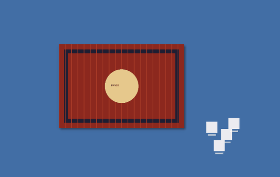

# 🧺 바탕화면 러그

**정리하기 귀찮은 바탕화면 아이콘들, 그냥 러그로 덮어버리세요.**

좋아하는 캐릭터 그림을 넣으면 AI가 자동으로 누끼를 따서 
진짜 천처럼 끌리고, 접히고, 구겨지는 러그로 만들어 줘요.

### [⬇️ 다운로드 (Windows)](../../releases/latest)

## ✨ 이런 걸 할 수 있어요

- 🖼️ **아무 그림이나 러그로**: 캐릭터, 사진, 일러스트를 넣으면 AI가 배경을 지워줘요
- 🧶 **진짜 천 같은 움직임**: 잡고 끌면 출렁이며 따라오고, 모서리를 안쪽으로 끌면 접혀요
- 〰️ **흐물거림 조절**: 0(빳빳)부터 100(완전 흐물흐물)까지 내 맘대로
- ✨ **쫙 펼치기**: 더블클릭하면 이불 털듯이 쫙 펴져요
- 💾 **그대로 기억**: 껐다 켜도 접힌 모양과 위치가 그대로예요
- 🚀 **자동 실행**: 컴퓨터를 켜면 알아서 러그가 깔려 있어요
- ⬆️ **자동 업데이트**: 새 버전이 나오면 "업데이트 하기" 버튼 한 번이면 끝
- ⚡ **성능 모드**: 가볍게(30fps) / 보통(60fps) / 부드럽게(그래픽카드로 매끈하게)

## ⬇️ 설치 방법

1. [Releases](../../releases/latest)에서 `DesktopRug-...-windows.zip`을 받아요
2. 압축을 풀어요 (zip 우클릭 → **모두 압축 풀기**)
3. 폴더 안의 **`DesktopRug.exe`** 를 더블클릭해요
4. 그림 고르는 창이 뜨면 러그로 만들 그림을 골라요. 끝!

> **"Windows의 PC 보호" 창이 떠요!**
> 개인이 만든 프로그램이라 서명이 없어서 뜨는 경고예요. **추가 정보 → 실행**을 누르면 돼요.

> 처음 AI 누끼를 쓸 때 AI 모델(약 170MB)을 한 번 내려받아요. 1~2분 정도 걸리고, 다음부터는 몇 초면 돼요.

## 🖱️ 조작법

| 동작 | 하는 일 |
|---|---|
| 드래그 | 천처럼 끌기 (모서리를 안쪽으로 끌면 접힘) |
| 더블클릭 | 쫙 펼치기 |
| 마우스 휠 | 크기 조절 |
| Ctrl + 휠 | 투명도 조절 |
| Shift + 휠 | 흐물거림 조절 |
| 그림 파일을 러그 위로 끌어다 놓기 | 그림 바꾸기 |
| 우클릭 | 전체 메뉴 (흐물거림, 크기, 투명도, 반전, 잠금, 복제, 삭제 …) |

작업표시줄 오른쪽 **트레이 아이콘**에서 새 러그 만들기 · 모두 숨기기 · 윈도우 시작 시 자동 실행 · 종료를 할 수 있어요.

## ❓ 자주 묻는 질문

**러그 밑에 있는 아이콘은 어떻게 써요?**
트레이 아이콘을 더블클릭하면 러그가 전부 숨겨져요. 한 번 더 더블클릭하면 다시 나타나요.

**컴퓨터가 버벅여요.**
트레이 아이콘 → ⚡ 성능 → 🔋 절약을 골라주세요. 러그가 가만히 있을 땐 CPU를 거의 안 써요.

**Win+D(바탕화면 보기)를 누르면 러그도 사라져요.**
최신 버전에서는 Win+D를 눌러도 러그가 그대로 보여요. 트레이 아이콘 → 🖥 Win+D 눌러도 러그 보이기가 켜져 있는지 확인해 주세요.

**러그가 화면 밖으로 나갔어요.**
트레이 아이콘 → 🧲 러그 전부 불러오기를 누르면 화면 가운데로 모여요.

**지우고 싶어요.**
트레이 아이콘 → 종료한 다음 폴더를 지우면 돼요. 설정과 그림은 `%APPDATA%\DesktopRug`에 있어요.

**Mac에서도 되나요?**
지금은 Windows만 지원해요.

## 🙏 사용한 것들

- AI 누끼 모델: [rembg](https://github.com/danielgatis/rembg) 프로젝트에서 배포하는 IS-Net 모델 (실행 중에 내려받음)
- [Qt for Python (PySide6)](https://www.qt.io/qt-for-python) · LGPL v3
- [ONNX Runtime](https://onnxruntime.ai) · MIT
- [Pillow](https://python-pillow.org) · [NumPy](https://numpy.org)

---

made by 망고 🥭

